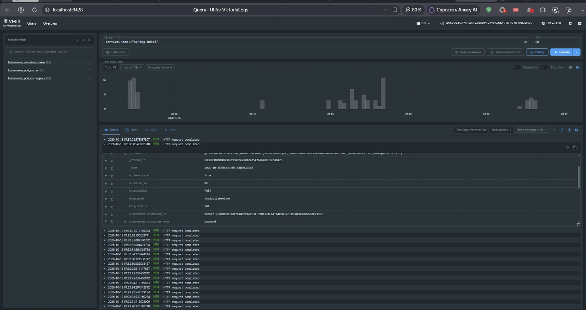
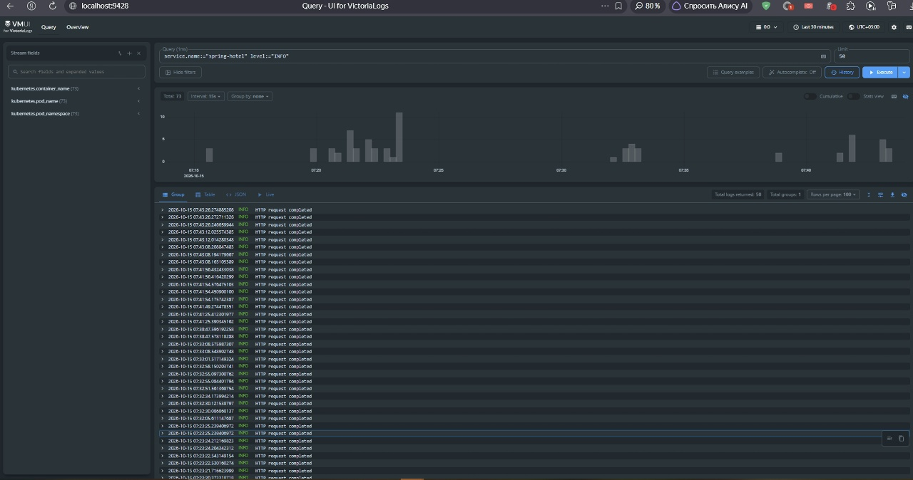
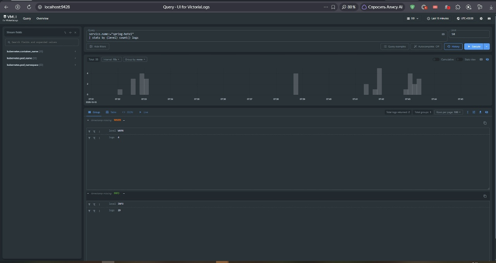
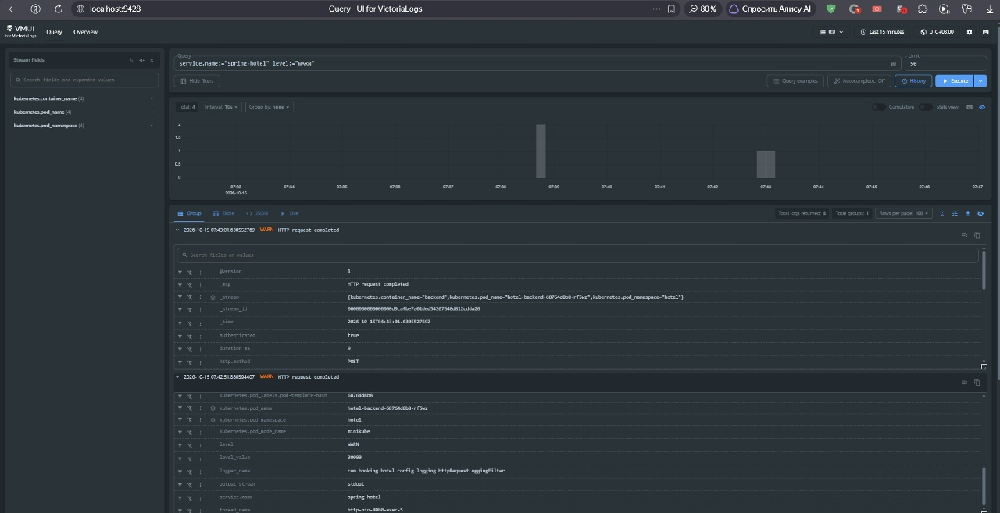
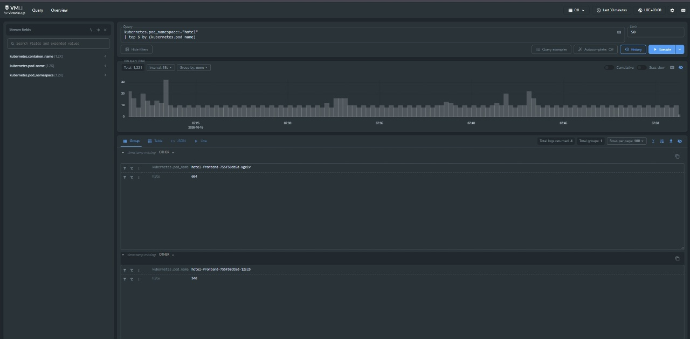

# Отчёт о настройке централизованного логирования

## 1. Цель работы

Цель работы — развернуть VictoriaLogs в том же однодовом кластере Minikube, в котором работает приложение Spring Hotel, настроить структурированное логирование backend в формате JSON и организовать автоматическую доставку контейнерных логов в централизованное хранилище.

После настройки логи приложения доступны для поиска и анализа через встроенный веб-интерфейс VictoriaLogs `vmui` и язык запросов LogsQL.

## 2. Использованные компоненты

В решении используются:

- Spring Boot backend — формирует структурированные JSON-логи в stdout контейнера;
- HTTP-фильтр backend — создаёт отдельную запись после обработки каждого HTTP-запроса;
- VictoriaLogs single-node — принимает, хранит и обрабатывает логи;
- VictoriaLogs Collector (`vlagent`) — читает контейнерные логи Kubernetes и передаёт их в VictoriaLogs;
- Helm — устанавливает и обновляет VictoriaLogs и collector;
- Minikube — предоставляет локальный однодовый Kubernetes-кластер;
- PersistentVolumeClaim — сохраняет данные VictoriaLogs при пересоздании Pod.

Конфигурация инфраструктуры находится в файлах:

- `observability/victoria-logs-values.yaml`;
- `observability/collector-values.yaml`.

## 3. Развёртывание VictoriaLogs

VictoriaLogs установлена официальным Helm chart `victoria-logs-single` в отдельном namespace `observability`:

```powershell
helm upgrade --install vls vm/victoria-logs-single --namespace observability --values .\observability\victoria-logs-values.yaml --wait --timeout 5m
```

Используется single-node установка с одной репликой. Для хранения данных выделен PVC размером `2Gi`. Срок хранения логов настроен на семь дней. Для контейнера заданы requests и limits процессора и памяти.

После установки в namespace `observability` работают:

- Pod `vls-victoria-logs-single-server-0`;
- Service `vls-victoria-logs-single-server`;
- PersistentVolumeClaim VictoriaLogs.

Для локального доступа к vmui используется port-forward:

```powershell
kubectl port-forward service/vls-victoria-logs-single-server 9428:9428 -n observability
```

Веб-интерфейс доступен по адресу:

```text
http://localhost:9428/select/vmui/
```

## 4. Структурированные JSON-логи приложения

Spring Boot настроен на вывод структурированных логов Logstash в stdout:

```properties
logging.structured.format.console=logstash
logging.structured.json.rename.[@timestamp]=timestamp
logging.structured.json.add.service.name=${spring.application.name}
```

Основные поля записи:

- `timestamp` — время события;
- `level` — уровень логирования;
- `message` — текст сообщения;
- `service.name` — имя сервиса;
- `logger_name` — Java-логгер, создавший запись;
- `thread_name` — поток выполнения.

Пример системного лога backend:

```json
{
  "timestamp": "2026-10-15T04:07:32.748565245Z",
  "message": "Started HotelApplication",
  "logger_name": "com.booking.hotel.HotelApplication",
  "thread_name": "main",
  "level": "INFO",
  "service.name": "spring-hotel"
}
```

В приложение добавлен общий HTTP-фильтр. После обработки запроса он создаёт запись `HTTP request completed` со следующими дополнительными полями:

- `http.method` — HTTP-метод;
- `http.path` — путь запроса;
- `http.status` — код HTTP-ответа;
- `duration_ms` — продолжительность обработки в миллисекундах;
- `authenticated` — наличие аутентифицированного пользователя.

Это позволяет связывать действия пользователя во frontend с конкретными записями backend.

## 5. Доставка логов

VictoriaLogs Collector установлен официальным Helm chart `victoria-logs-collector`:

```powershell
helm upgrade --install vlc vm/victoria-logs-collector --namespace observability --values .\observability\collector-values.yaml --wait --timeout 5m
```

Collector работает как DaemonSet. В однодовом Minikube запускается один экземпляр collector на ноде `minikube`. Он читает контейнерные логи Kubernetes и отправляет их по HTTP во внутренний Service VictoriaLogs:

```text
http://vls-victoria-logs-single-server:9428
```

Общая схема доставки:

```text
Spring Boot backend
  → JSON-логи в stdout контейнера
  → контейнерные логи на ноде Minikube
  → VictoriaLogs Collector DaemonSet
  → Service vls-victoria-logs-single-server:9428
  → VictoriaLogs StatefulSet
  → PersistentVolumeClaim
```

Collector добавляет к событиям Kubernetes-метаданные:

- `kubernetes.container_name`;
- `kubernetes.pod_name`;
- `kubernetes.pod_namespace`;
- labels Pod.

Логи системного namespace `kube-system` и самой системы наблюдаемости `observability` исключены из сбора:

```text
kubernetes.pod_namespace:in(kube-system, observability)
```

### Обоснование выбранного способа

DaemonSet выбран вместо sidecar-контейнеров, потому что один collector на каждой Kubernetes-ноде может читать логи всех размещённых на ней Pod. Не требуется изменять Deployment каждого сервиса или запускать дополнительный контейнер рядом с каждым экземпляром backend и frontend.

Такой подход удобен для масштабирования: при увеличении количества реплик приложения новые Pod автоматически попадают под сбор логов. При добавлении новой ноды Kubernetes DaemonSet автоматически запускает на ней новый экземпляр collector.

## 6. Проверка работоспособности

Состояние компонентов проверяется командами:

```powershell
kubectl get daemonset,pods -n observability
kubectl get pods -n hotel -o wide
```

Во время проверки были получены следующие результаты:

- VictoriaLogs Pod — `Running`, готовность `1/1`;
- collector Pod — `Running`, готовность `1/1`;
- collector DaemonSet — `DESIRED 1`, `READY 1`, `AVAILABLE 1`;
- backend Pod — `Running`, готовность `1/1`;
- PostgreSQL Pod — `Running`, готовность `1/1`;
- Liquibase Job — `Completed`.

В логах collector присутствует сообщение:

```text
started Kubernetes log collector for node "minikube"
```

Это подтверждает запуск сборщика контейнерных логов на ноде Minikube.

## 7. LogsQL-запросы

Для запросов в vmui вручную выбирается диапазон `Last 30 minutes`. Поэтому фильтр `_time` в текст запросов не добавляется. Перед созданием скриншотов через frontend выполняются CRUD-операции, чтобы сформировать свежие HTTP-логи.

### 7.1. Сырые записи приложения

```logsql
kubernetes.pod_namespace:="hotel"
```

Запрос выводит необработанные записи компонентов приложения из namespace `hotel`. Он используется для проверки того, что логи backend, frontend, PostgreSQL и Liquibase поступают в VictoriaLogs вместе с Kubernetes-метаданными.


  

### 7.2. Фильтрация по конкретному полю

```logsql
service.name:="spring-hotel" level:="INFO"
```

Запрос оставляет только информационные записи Spring Boot backend. Он демонстрирует фильтрацию по структурированным полям `service.name` и `level`, а не поиск по произвольному тексту сообщения.


 

### 7.3. Статистика с группировкой

```logsql
service.name:="spring-hotel"
| stats by (level) count() logs
```

Запрос группирует записи backend по полю `level` и подсчитывает количество записей каждого уровня. Результат позволяет увидеть распределение сообщений `INFO`, `WARN` и `ERROR` за выбранный период.



### 7.4. Дополнительная фильтрация предупреждений

```logsql
service.name:="spring-hotel" level:="WARN"
```

Запрос оставляет предупреждения Spring Boot backend. В частности, он позволяет найти сообщения Hibernate о применении устаревших аннотаций. Этот запрос дополняет фильтр `INFO` и показывает, что одно и то же структурированное поле можно использовать для выбора разных уровней событий.




### 7.5. Агрегирующий запрос top

```logsql
kubernetes.pod_namespace:="hotel"
| top 5 by (kubernetes.pod_name)
```

Запрос выводит до пяти Pod приложения, создавших наибольшее количество записей. Поле `hits` содержит число событий каждого Pod. Запрос помогает определить наиболее активные источники логов в namespace приложения.


 

## 8. Результат

В Minikube развёрнута single-node VictoriaLogs с постоянным хранилищем. Spring Boot backend формирует структурированные JSON-логи в stdout. VictoriaLogs Collector автоматически читает контейнерные логи приложения, добавляет Kubernetes-метаданные и передаёт события в VictoriaLogs.

Через vmui выполнены запросы, демонстрирующие:

1. получение сырых записей за выбранный период;
2. фильтрацию информационных сообщений по структурированным полям;
3. подсчёт записей с группировкой;
4. отдельную фильтрацию предупреждений;
5. агрегирование с помощью `top`.

Требования задания по развёртыванию VictoriaLogs, JSON-логированию, доставке событий и анализу логов с помощью LogsQL выполнены.
